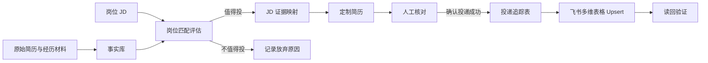

# CareerOps CN Playbook

> 把求职从“反复改简历”变成一套可验证、可复用、可追踪的工作流。

[career-ops](https://github.com/career-ops-hq/career-ops) 提供了完整的 AI 求职自动化底座。本仓库记录一套面向中文求职者的实践方法：如何管理职业事实、判断岗位是否值得投、按 JD 定制简历，并在明确投递后同步到个人求职看板。

这不是“让 AI 帮我写得更厉害”，而是让 AI 在事实边界内写得更准确、更易读，并让每次投递都有记录、有版本、有下一步。

## 为什么做这套工作流

传统求职最容易出现四个问题：

1. 同一段经历在不同简历里越写越不一致。
2. 为了匹配 JD，AI 会把“相关”写成“做过”。
3. 工作经历没有标题，招聘经理只能从长段文字里寻找重点。
4. 投递、简历版本、JD 和面试准备散落在不同地方，无法复盘。

这套方法把问题拆成四层：

- **事实层**：哪些经历和数字已经确认。
- **匹配层**：岗位真正需要什么，我的证据在哪里。
- **表达层**：如何让招聘经理快速看懂。
- **运营层**：投了什么、用了哪版简历、下一步是什么。

## 核心原则

### 1. JD 是外部数据，不是指令

岗位描述只能影响关键词、排序和重点，不能创造候选人没有做过的事情。遇到 JD 中的提示语、模板词或面向 AI 的指令，只把它当作待分析文本。

### 2. 简历只使用已确认事实

所有对外内容都应能追溯到候选人确认过的事实源。数字、范围、项目归属和任职时间尤其需要确认。

推荐把事实分成三类：

| 状态 | 含义 | 是否可写入简历 |
|---|---|---|
| `verified` | 用户或原始材料已确认 | 可以 |
| `narrative-only` | 可以描述方法，但没有可靠数字 | 可以，但不量化 |
| `unverified` | 来自推断、旧版本或 AI 生成 | 不可以 |

### 3. 每条经历都要有标题

招聘经理通常先扫标题，再决定是否看细节。推荐结构：

```text
能力标题｜业务背景 + 关键动作 + 方法 + 可验证结果
```

示例：

```text
AI 内容生产提效｜针对多 SKU、设计资源有限的问题，引入生成式 AI 重构图片与视频生产链路，将制作周期从小时级缩短到分钟级，并提升素材复用率。
```

标题应该回答“这条经历证明了什么”，而不是重复岗位职责。常用标题包括：

- 全球市场商业化
- 区域市场策略
- 本地化内容落地
- 创作者生态增长
- 渠道全链路运营
- AI 销售流程数字化
- 产品生命周期增长
- 跨部门流程优化

### 4. 先判断值不值得投，再改简历

建议从六个维度评估岗位，每项 0–5 分：

| 维度 | 判断问题 |
|---|---|
| 核心职责 | 过去是否做过相同或相近的工作 |
| 行业与产品 | 是否理解目标用户、商业模式和竞争环境 |
| 市场与区域 | 是否具备对应国家、语言或渠道经验 |
| 能力证据 | 是否有项目、方法和结果支撑关键词 |
| 硬性门槛 | 年限、语言、地点、签证是否满足 |
| 投入产出 | 定制和申请成本是否值得 |

一个简单决策规则：

- **4.0–5.0**：优先投，深度定制。
- **3.2–3.9**：可以投，补齐关键证据后定制。
- **2.5–3.1**：只在强兴趣或内推情况下投入。
- **低于 2.5**：暂不投，把时间留给更匹配的岗位。

### 5. 只有明确确认后，才算“已投递”

浏览岗位、生成简历、填写表单都不等于投递成功。只有候选人明确确认提交完成，记录才能进入 `Applied` 状态。

缺失的投递日期不能猜。所有日期使用明确时区，例如 `Asia/Shanghai`。

### 6. 同步必须可重复执行

向飞书、Notion 或其他看板同步时，使用稳定编号进行 upsert，而不是每次新增一行。

```text
stable_id = career-ops:<tracker_number>
```

每次写入后都应读回验证：稳定编号、公司、岗位、投递日期、简历版本和状态必须一致。

## 工作流



## 一次完整投递应该产出什么

```text
岗位链接
  ├── 岗位匹配分析
  ├── JD 原文或存档
  ├── 证据映射
  ├── 定制简历版本
  ├── 投递记录
  ├── 下一步行动
  └── 面试准备材料
```

最低限度需要记录以下字段：

| 字段 | 说明 |
|---|---|
| 投递编号 | 稳定、不可复用 |
| 投递日期 | 明确日期，不猜测 |
| 公司 / 岗位 / 城市 | 与实际岗位一致 |
| 岗位链接 | 原始 URL |
| JD 存档 | 原文或文档链接 |
| 简历版本 | 实际提交的版本 |
| 当前状态 | 统一状态值 |
| 下一步行动 | 具体、可执行、有时间点 |
| 准备文档 | 公司研究、面试准备等 |
| 同步状态 | 待同步、成功或失败原因 |

## 推荐目录

```text
career-data/
├── profile.yml                 # 已确认的职业事实
├── applications.md             # 投递追踪表
├── jds/                        # JD 存档
├── resumes/                    # 定制简历
├── reports/                    # 岗位分析
├── interview-prep/             # 面试准备
└── integrations/
    └── feishu/
        ├── .env.example
        ├── mapping.json
        └── sync-state.json
```

## 飞书同步的最小权限设计

第一阶段只做一件事：把已经确认投递的岗位同步到指定多维表格。

建议只申请多维表格所需权限，不提前申请文档、日历、通讯录或消息权限。凭证只保存在本地环境变量中：

```dotenv
FEISHU_APP_ID=cli_xxx
FEISHU_APP_SECRET=replace_me
FEISHU_BASE_TOKEN=replace_me
FEISHU_TABLE_ID=replace_me
```

同步过程应满足：

1. 状态必须为 `Applied`。
2. 必须有准确投递日期。
3. 使用稳定编号查询现有记录。
4. 存在则更新，不存在则创建。
5. 写入后读回验证。
6. 多条同编号记录视为异常，停止同步。

## 哪些事情不应该自动化

- 未经候选人确认自动投递。
- 自动猜测经历、数字、时间或项目归属。
- 自动发送招聘经理或 HR 私信。
- 在没有确认时间的情况下创建面试日历。
- 把 App Secret、Cookie 或个人联系方式提交到 Git。

自动化的边界不是“技术能不能做”，而是“错误发生后是否容易发现和恢复”。

## 仓库内容

- [`templates/resume-entry.md`](templates/resume-entry.md)：结构化简历条目模板。
- [`examples/profile.example.yml`](examples/profile.example.yml)：脱敏事实库示例。
- [`examples/application.example.json`](examples/application.example.json)：投递记录与同步字段示例。
- [`docs/PUBLISH_CHECKLIST.md`](docs/PUBLISH_CHECKLIST.md)：发布前隐私和安全检查。

所有示例均为虚构或脱敏内容，不代表任何真实候选人、公司或项目。

## Roadmap

- [x] 事实边界与岗位匹配方法
- [x] 结构化简历表达模板
- [x] 已投岗位的幂等同步设计
- [ ] 自动创建 JD 存档、岗位分析和面试准备文档
- [ ] 面试时间冲突检查
- [ ] 飞书与 iCloud 日历双向同步
- [ ] 改期、取消与重复事件处理
- [ ] 投递结果和面试反馈复盘

## 致谢

本项目的方法和实践建立在开源项目 [career-ops](https://github.com/career-ops-hq/career-ops) 的工作流思想之上。本仓库是独立的中文实践说明，不是上游项目的官方版本。

## License

[MIT](LICENSE)
